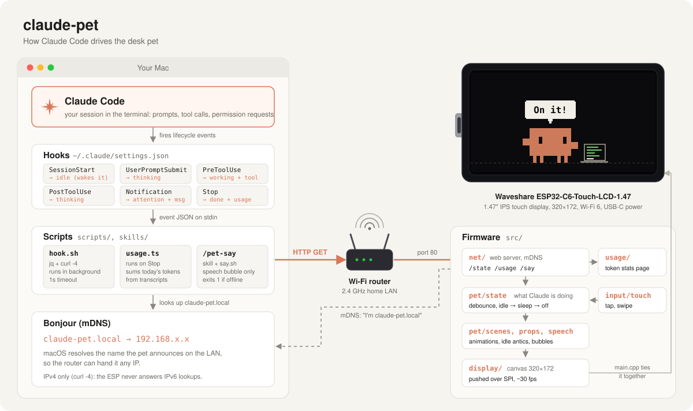

# claude-pet

A pixel-art desk buddy that acts out what Claude Code is doing. It runs on a small ESP32 touchscreen board: it paces while Claude thinks, types on a laptop while Claude runs commands, jumps and waves when Claude needs you, and naps when nothing is going on.



## What it does

| Claude is... | The bot |
|---|---|
| thinking | paces back and forth, hand on chin, thought bubble |
| running Bash | walks to a laptop and types, code scrolls on the screen |
| using Edit / Write | carries blocks from a pile to a growing stack |
| using Read / Grep / Web | wanders around with a magnifying glass |
| running a subagent (Task / Agent) | three tiny copies follow it around |
| using any other tool | juggles |
| waiting for you (Notification) | jumps, waves, shows Claude's message in a speech bubble, the screen border flashes |
| finished (Stop) | jumps with confetti |
| idle | does its own thing: wanders, waves, stretches, dances, hops, naps, leaves the screen and comes back, chases a fly |
| idle 10+ minutes | sits down and sleeps, screen dims |
| idle 1+ hour | screen off; the next hook event or a tap wakes it |
| connecting to Wi-Fi | stands in the middle with an arm up like an antenna, scanning, while a Wi-Fi icon fills up; hops and says "Connected!" once online |
| no Wi-Fi for 20+ s | sits down looking sad under a crossed-out Wi-Fi icon, keeps retrying every 15 s |

Touch:

- **tap**: poke the bot (it hops, a heart pops up), dismiss "needs you", or wake it up
- **swipe sideways**: switch to the usage page (today's tokens, sessions, last 7 days)

The bot also talks in speech bubbles. Claude's own messages (like a permission request) take priority, otherwise it picks a short line that fits what it's doing. Claude Code's spinner word ("Scampering...") isn't passed to hooks, so while thinking the pet picks from its own list of similar words.

## Hardware

**Board:** [Waveshare ESP32-C6-Touch-LCD-1.47](https://www.waveshare.com/wiki/ESP32-C6-Touch-LCD-1.47)

- ESP32-C6, Wi-Fi 6 (2.4 GHz only), 8 MB flash
- 1.47" 172×320 IPS display (JD9853 driver), used in landscape
- AXS5106L capacitive touch, QMI8658 IMU (unused)

Notes:

- The pin table on Waveshare's wiki is wrong. The pins in `src/config.h` come from their demo code and schematic.
- The onboard red PWR and green CHG LEDs are hardwired to power and the charger chip. They can't be controlled from code.

## How it works

Everything goes over your home Wi-Fi. USB is only for power and flashing.

1. **Claude Code fires hooks.** `~/.claude/settings.json` runs `scripts/hook.sh <state>` on each lifecycle event, passing the event as JSON on stdin.
2. **`hook.sh` sends an HTTP request.** It pulls the tool name and message out with `jq` and calls `curl -4 http://claude-pet.local/state?...` in the background with a 1 second timeout, so Claude never waits on it.
3. **Bonjour finds the board.** The firmware announces itself over mDNS as `claude-pet.local`, so the Mac doesn't need to know its IP.
4. **The ESP32 updates the pet.** A small web server on port 80 sets the new state, and the main loop picks the matching animation on the next frame (~30 fps).

The Mac always starts the conversation and the board only answers. Several Claude sessions share one pet: the latest event wins.

### HTTP API

| Request | Sent by | Effect |
|---|---|---|
| `GET /state?s=<state>&tool=<name>&msg=<text>` | `scripts/hook.sh` | changes what the pet is doing |
| `GET /usage?today=N&sessions=N&week=a,b,c,d,e,f,g` | `scripts/usage.ts`, after each reply | updates the token stats |
| `GET /say?msg=<text>&ms=<duration>` | `skills/pet-say/say.sh` (the `/pet-say` skill) | speech bubble only, the state doesn't change |
| `GET /` | you | returns the current state |

States: `idle`, `thinking`, `working`, `attention`, `done`, `sleep`, `off`.

```sh
curl -4 "http://claude-pet.local/state?s=attention&msg=hello"
curl -4 http://claude-pet.local/
```

There is no authentication: anyone on your Wi-Fi can send it messages.

## Setup

Requirements: [just](https://github.com/casey/just), [PlatformIO](https://platformio.org/) Core 6.2+, `jq`, `curl` and Node 26+ (runs `usage.ts` directly). The firmware uses the [pioarduino](https://github.com/pioarduino/platform-espressif32) platform, which supports the C6 with Arduino.

### 1. Wi-Fi

```sh
just setup
```

This creates `src/secrets.h` from `src/secrets.example.h` and reports any missing tools. Fill in `WIFI_SSID` and `WIFI_PASS` (a 2.4 GHz network). `secrets.h` is gitignored, so your credentials stay out of git. With an empty SSID the board runs in **demo mode** and cycles through every scene.

### 2. Flash

Plug the board in over USB, then:

```sh
just dev   # flash + serial console, prints "ready: http://claude-pet.local (192.168.x.x)" once on Wi-Fi
```

### 3. Claude Code hooks and the skill

```sh
just install
```

This adds the hooks to `~/.claude/settings.json` (after backing it up to `settings.json.bak`) and symlinks the `/pet-say` skill into `~/.claude/skills`. Running it again won't duplicate anything, and it keeps any other hooks you have. Start a new Claude session afterwards. `just uninstall-hooks` removes them again.

<details>
<summary>Manual hook setup</summary>

Add this to `~/.claude/settings.json`, adjusting the path to where the repo lives:

```json
"hooks": {
  "SessionStart":     [{ "hooks": [{ "type": "command", "command": "/path/to/claude-pet/scripts/hook.sh idle" }] }],
  "UserPromptSubmit": [{ "hooks": [{ "type": "command", "command": "/path/to/claude-pet/scripts/hook.sh thinking" }] }],
  "PreToolUse":  [{ "matcher": "*", "hooks": [{ "type": "command", "command": "/path/to/claude-pet/scripts/hook.sh working" }] }],
  "PostToolUse": [{ "matcher": "*", "hooks": [{ "type": "command", "command": "/path/to/claude-pet/scripts/hook.sh thinking" }] }],
  "Notification": [{ "hooks": [{ "type": "command", "command": "/path/to/claude-pet/scripts/hook.sh attention" }] }],
  "Stop": [{ "hooks": [{ "type": "command", "command": "/path/to/claude-pet/scripts/hook.sh done" }] }]
}
```

And for the skill: `ln -s "$PWD/skills/pet-say" ~/.claude/skills/pet-say`

</details>

### 4. Try it

```sh
just tour            # walks the pet through every state, 5s each
just say "hello!"    # speech bubble
```

In Claude, ask it to "show 'lunch time!' on the pet", or run `/pet-say hello`.

## Commands

| Command | What it does |
|---|---|
| `just setup` | create `src/secrets.h`, check tools |
| `just install` | hooks + `/pet-say` skill (`install-hooks`, `install-skill` separately) |
| `just uninstall-hooks` | remove the pet hooks, keep the rest of your settings |
| `just build` | compile the firmware |
| `just flash` | compile and flash over USB |
| `just monitor` | serial console |
| `just dev` | flash, then serial console |
| `just clean` | delete build output |
| `just say "msg" [ms]` | speech bubble, optional duration |
| `just state <name> ["msg"] ["tool"]` | set a state, e.g. `just state working "" Bash` |
| `just status` | current state, or "not reachable" |
| `just tour` | every state in a row |
| `just usage` / `just usage-dry` | push today's tokens now / just print them |

Set `CLAUDE_PET_HOST` to use an IP instead of `claude-pet.local`.

## Project structure

```
src/
  main.cpp          wires the modules together, runs the frame loop
  config.h          pins, screen size, timings, brightness
  secrets.h         Wi-Fi + time zone (gitignored, see secrets.example.h)
  display/          screen init, backlight, colors, text helpers
  pet/
    state.*         what Claude is doing, debounce, idle -> sleep -> off
    bot.*           the 16x10 pixel-art sprite
    scenes.*        movement and poses per state, idle antics
    props.*         laptop, blocks, magnifier, bubbles, confetti, the fly
    speech.*        speech bubbles and their lines
    demo.*          scene cycle used until Wi-Fi is configured
  ui/pages.*        pet page and status line, usage page
  input/touch.*     tap and swipe detection
  net/net.*         Wi-Fi, mDNS, HTTP API
  usage/usage.*     token stats and formatting
lib/axs5106l/       touch driver from the Waveshare demo
scripts/
  hook.sh           Claude Code hook -> /state
  usage.ts          sums today's tokens from ~/.claude/projects -> /usage
skills/pet-say/
  SKILL.md          Claude Code skill for sending messages
  say.sh            speech bubble from the terminal -> /say
docs/flow.svg       the diagram above
justfile            setup, build, flash and test commands
```

## Tuning

Most knobs are in `src/config.h`:

| Setting | Default | What it does |
|---|---|---|
| `ROTATION` | `1` | `1` or `3`: which side the USB port ends up on |
| `U` | `6` | bot pixel size |
| `SLEEP_AFTER_MS` | 10 min | idle time before it falls asleep |
| `OFF_AFTER_MS` | 1 h | idle time before the screen turns off |
| `NO_WIFI_AFTER_MS` | 20 s | how long "connecting" shows before "no wifi" |
| `WIFI_RETRY_MS` | 15 s | how often it retries while offline |
| `THINK_DEBOUNCE_MS` | 1.5 s | delay before "thinking" after a tool, so back-to-back tools don't flicker |
| `BL_ON` / `BL_SLEEP` | 255 / 25 | backlight brightness awake / asleep |

Idle antic weights and durations are in the `ANTICS` table in `src/pet/scenes.cpp`. Speech lines are at the top of `src/pet/speech.cpp`. Tool-to-animation mapping is `activityFor()` in `src/pet/state.cpp`.

## Troubleshooting

- **Requests to `claude-pet.local` hang for ~5 seconds.** macOS also asks for an IPv6 address, which the ESP never answers. Use `curl -4`; the scripts already do.
- **`IncompatiblePlatform ... depends on PlatformIO Core >=6.2.0`.** Run `pio upgrade`. If the newest pioarduino release still refuses your core version, pin an older release in `platformio.ini`.
- **The screen is upside down.** Change `ROTATION` in `src/config.h` between `1` and `3`.
- **The pet doesn't react to Claude.** Check `curl -4 http://claude-pet.local/` answers, and start a new Claude session after editing hooks.
- **It never connects.** The C6 only sees 2.4 GHz networks. `pio device monitor` shows the "ready" line with its IP once it's on Wi-Fi.
